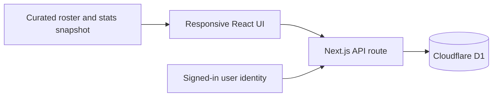

# NBA Lab

NBA Lab is a personal preseason forecasting workspace for turning NBA opinions into a structured, connected season model. It combines team reviews, standings predictions, playoff picks, awards and player rankings in one responsive application.

The product was designed for an annual offseason workflow: import a reliable roster snapshot once, then layer personal analysis and predictions on top of it throughout the season preview process.

## What it does

- Reviews every team using flexible, weighted letter-grade categories.
- Builds projected East, West and league-wide standings with win-total validation.
- Seeds an interactive play-in and playoff bracket from the projected standings.
- Tracks top-three award predictions and All-NBA, All-Defense and All-Rookie teams.
- Ranks players from 65–99 with filters for position, rotation role, conference, age and minimum rating.
- Compares starting lineups and benches using the same roster rules as the team workspace.
- Persists each signed-in user's forecasts separately, so the same work is available on mobile and desktop.

## Product rules

- Starting lineups are organized by position: PG, SG, SF, PF and C.
- Benches are organized by player rating.
- Players with the same rating can be manually reordered to break ties.
- Player-rating changes do not immediately reshuffle the list while the slider is being used. Rankings refresh on a deliberate interaction such as changing a filter, reopening the tab or organizing a roster.
- Training-camp invitees and two-way players are excluded from the roster snapshot.

## Main surfaces

| Surface | Purpose |
| --- | --- |
| Teams | Previous-season context, future grades, flexible categories and roster roles |
| Standings | Win projections, conference ordering and league-balance validation |
| Playoffs | Side-by-side play-in games and a converging playoff bracket |
| Players | Rating workflow, tie-breaking and multi-dimensional filters |
| Compare | Starting-five and bench-strength comparisons |
| Awards | Podium predictions and end-of-season teams |

## Architecture



The repository contains application code and the public roster/statistics snapshot. Personal ratings, brackets and predictions are stored in D1 and are not committed to Git.

## Tech stack

- TypeScript, React 19 and Next.js 16
- Vinext and Vite for Cloudflare Workers
- Tailwind CSS and accessible Radix/Shadcn primitives
- Cloudflare D1 with Drizzle ORM
- OpenAI Sites hosting and signed-in user identity

## Local development

Requirements:

- Node.js 22.13 or newer
- npm

```bash
npm ci
npm run dev
```

Open the local URL printed by Vite. The interface loads with its default dataset. User-specific cloud persistence requires an environment that supplies the authenticated user header and the D1 binding declared in `.openai/hosting.json`.

Useful commands:

```bash
npm run build
npm run test
npm run lint
```

## Data and privacy

- Roster, biographical and previous-season statistical snapshots are stored under `lib/imported-*.json`.
- Imported basketball information is used as factual reference data and should be refreshed before a new preseason cycle.
- User-created forecasts are stored outside the repository and keyed by user and season.
- Environment files, local database state, build output and credentials are excluded through `.gitignore`.

## Data attribution and disclaimer

The roster and historical-statistics workflow was prepared using Basketball Reference as a reference source. Team marks and logos are displayed for identification purposes and remain the property of their respective owners.

NBA Lab is an independent, non-commercial fan project. It is not affiliated with, endorsed by or sponsored by the NBA, its teams or Basketball Reference.

## Repository status

This repository represents the working 2026/27 season version of NBA Lab. The hosted instance is private because it contains a personal prediction workspace; the source repository does not include the owner's saved forecasts.
